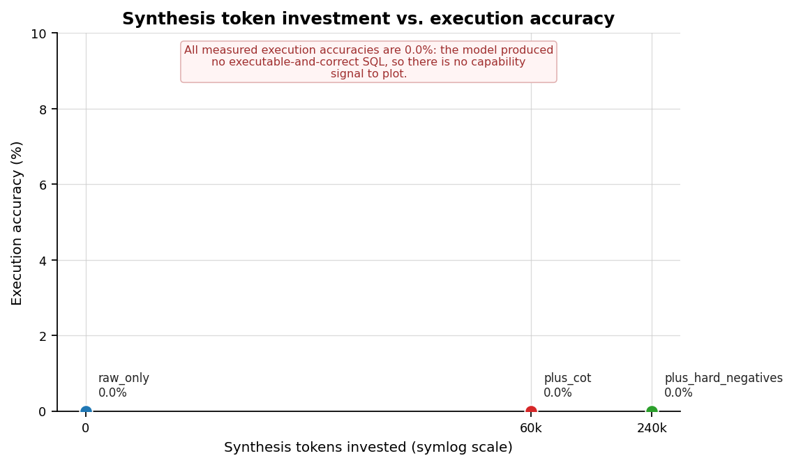
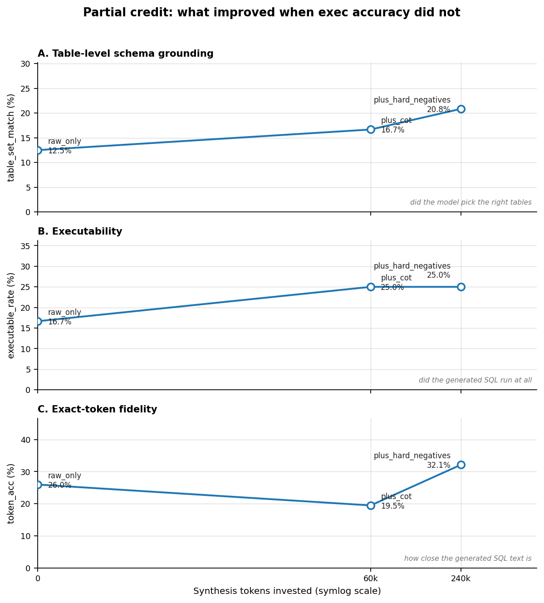
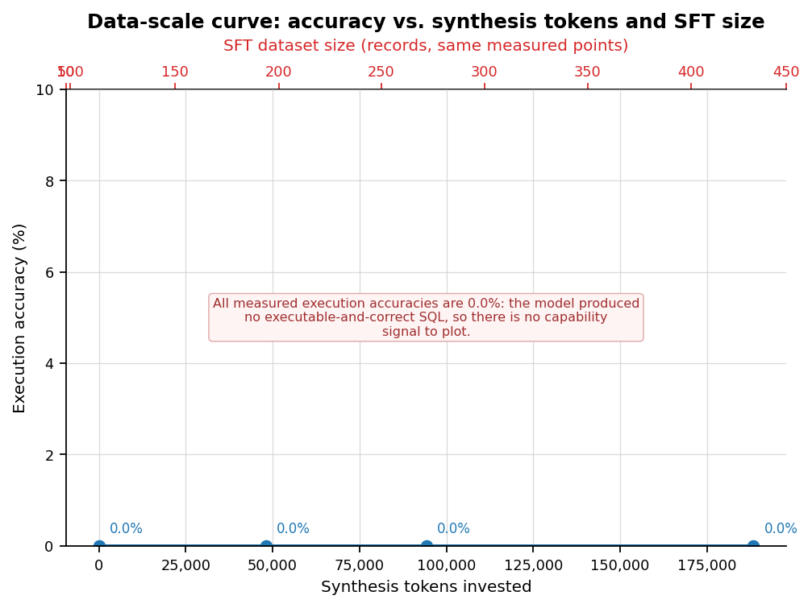

# Results: token investment → execution accuracy

_Every accuracy number below was produced by executing the model's SQL against real SQLite databases (`fcdata.dbexec.evaluate_pair`). No metric in this file is simulated or hardcoded._

_SFT corpus source: `artifacts\04_sft\train.jsonl`._

_Evaluated on 24 dev examples, identical across every configuration. One example is worth 4.17 percentage points, so treat small differences as indicative rather than established; the bootstrap CIs in the tables show the resulting uncertainty._

## Findings

- **Execution accuracy did not improve.** Both `raw_only` and `plus_hard_negatives` scored 0.0% after 239,883 synthesis tokens. Reported as measured; not adjusted.
- **Improved with synthetic data:** table-level schema grounding 12.5% → 20.8%; exact-token fidelity 26.0% → 32.1%; executability 16.7% → 25.0%; clause-structure agreement 12.1% → 20.0%.
- **Worsened with synthetic data:** column F1 22.8% → 19.4%.
- **How small is this sample?** Every arm scored the same 24 dev examples, so one example is worth 4.17 pp. The table-grounding move of 12.5% → 20.8% is 2 of 24 examples. The bootstrap CIs overlap substantially, so this is a directional signal worth investigating at scale, not an established effect.
- **Why the trade-off:** the richest arm trains on 542 records vs 98 for the baseline (5.5× more data) at the same fixed step budget, so each record is seen proportionally fewer times. At this model scale that buys schema coverage and costs exact token memorisation -- the two metrics move in opposite directions exactly as that explanation predicts.
- **What this does and does not show.** It shows the synthesis -> validation -> function-calling format -> SFT -> greedy decode -> real SQLite execution pipeline runs end to end and produces measurable, directional change in partial-credit metrics. It does not show a state-of-the-art text2sql model: the reference backend is a small transformer trained from scratch on a few hundred examples. The `hf` backend (Qwen2.5-7B + LoRA) is the path that turns this data into execution accuracy.

### Headline: no measurable execution-accuracy gain at this model scale

> **Strict execution accuracy did not move.** `raw_only` and `plus_hard_negatives` both scored 0.0% exec accuracy after spending **239,883 synthesis tokens** ($0.0113). This is the truthful result and it is reported unchanged.

That is expected arithmetic, not a broken pipeline: execution accuracy requires a byte-perfect statement, so it stays at zero for any model below roughly 99% token accuracy. Every number here came from really executing the generated SQL against SQLite.

**What did change:** the partial-credit metrics below, which decompose the task so a data-mix effect is visible even when strict accuracy is not. See *Findings* for the direction of each one and *How small is this sample?* for the caveat.

**Most likely cause: model capacity.** The reference backend is a small transformer trained from scratch on a few hundred examples at a fixed step budget. Adding several times more diverse synthetic data at the same budget means each record is seen far fewer times, so the extra diversity buys schema coverage but costs memorisation of exact token sequences. The `hf` backend (Qwen2.5-7B + LoRA) is the path that can turn this data into execution accuracy; the reference backend exists to validate the pipeline end-to-end, and it does.

| Metric | Value |
| :--- | ---: |
| Baseline exec acc | 0.0% |
| Best-mix exec acc | 0.0% |
| Accuracy gain | +0.0 pp |
| Synthesis tokens invested | 239,883 |
| Synthesis cost | $0.0113 |
| Accuracy points per 1M tokens | not measurable (no gain) |

## Figures

_Synthesis tokens invested vs. measured execution accuracy, one annotated point per ablation configuration, with a least-squares trend line. A flat line at zero is the honest statement of the headline metric at this model scale._

_Partial-credit metrics vs. synthesis tokens. This is where the measured effect lives when strict execution accuracy is flat: schema grounding rises while executability and token fidelity fall._

_Execution accuracy vs. synthesis tokens (bottom axis) and vs. SFT dataset size (top axis, same measured points)._

## Ablation: which synthesis kinds pay off

| Config | SFT records | Synth tokens | Synth cost (USD) | Exec acc | 95% CI | EM | Delta vs baseline |
| :--- | ---: | ---: | ---: | ---: | ---: | ---: | ---: |
| `raw_only` | 98 | 0 | $0.0000 | 0.0% | [0.0%, 0.0%] | 0.0% | baseline |
| `plus_cot` | 192 | 60,457 | $0.0036 | 0.0% | [0.0%, 0.0%] | 0.0% | ±0.0 pp |
| `plus_hard_negatives` | 542 | 239,883 | $0.0113 | 0.0% | [0.0%, 0.0%] | 0.0% | ±0.0 pp |

## Partial credit: what the model learned when exec accuracy is 0

_Strict execution accuracy requires a byte-perfect statement, so it is ~0 for any model below ~99% token accuracy. These metrics isolate the components of the task -- token agreement, query shape, schema grounding, clause structure -- and are computed from the same real generations._

| Config | Token acc | Skeleton | Table set | Table set 95% CI | Column F1 | Clause | Executable | Exec acc |
| :--- | ---: | ---: | ---: | ---: | ---: | ---: | ---: | ---: |
| `raw_only` | 26.0% | 0.0% | 12.5% | n/a | 22.8% | 12.1% | 16.7% | 0.0% |
| `plus_cot` | 19.5% | 0.0% | 16.7% | n/a | 15.3% | 9.8% | 25.0% | 0.0% |
| `plus_hard_negatives` | 32.1% | 0.0% | 20.8% | n/a | 19.4% | 20.0% | 25.0% | 0.0% |

### Failure taxonomy: which error class each data mix produced

_Maps onto the hard-negative error kinds the synthesis stage injects._

| Error class | `raw_only` | `plus_cot` | `plus_hard_negatives` |
| :--- | ---: | ---: | ---: |
| `not_executable` | 6 (25.0%) | 12 (50.0%) | 6 (25.0%) |
| `wrong_table` | 5 (20.8%) | 1 (4.2%) | 6 (25.0%) |
| `wrong_column` | 9 (37.5%) | 4 (16.7%) | 6 (25.0%) |
| `missing_join` | 1 (4.2%) | 3 (12.5%) | - |
| `extra_join` | 1 (4.2%) | - | 1 (4.2%) |
| `missing_order_by` | 1 (4.2%) | - | 1 (4.2%) |
| `wrong_values` | 1 (4.2%) | 3 (12.5%) | 1 (4.2%) |
| `unparseable` | - | 1 (4.2%) | - |
| `wrong_aggregate` | - | - | 3 (12.5%) |

## Data-scale curve: how much synthetic data is enough

_Scale curve not run: no `artifacts/06_eval/scale_curve.json` found._

## Validation funnel: what survived before training

| Stage | Records in | Records kept | Pass rate | Note |
| :--- | ---: | ---: | ---: | ---: |
| 1. Raw Spider examples | 98 | 98 | 100.0% | original dataset, no synthesis cost |
| 2. Synthesised records | 363 | 363 | - | cot + paraphrase + hard_negative |
| 5. Validated records | 348 | 348 | - | passed all enabled gates |
| 6. SFT training records | 446 | 446 | - | after format conversion (+ raw examples) |

## Token ledger by stage and role

_Token ledger is empty (no provider calls recorded yet)._

## Extrapolation to Spider scale

Measured on the demo corpus: **367,001 tokens** ($0.1949) for 98 source questions → 363 augmented records, i.e. **2,149 tokens per source question** (real ledger usage, not an estimate).

Projected linearly to Spider scale, the largest plan (`Augmented x5 (50k samples)`) is **72.05M tokens** for $21.8610 at the Spider-full point, which reaches the 10M-token target.

| Synthesis plan | Source questions | Augmented records | Synth tokens | Judge tokens | Total tokens | Est. cost (USD) |
|---|---:|---:|---:|---:|---:|---:|
| Spider train (7,000 q) | 7,000 | 28,000 | 16,243,702 | 12,064,915 | 28,308,617 | $15.03 |
| Spider full (10,181 q) | 10,181 | 40,724 | 23,625,305 | 17,547,557 | 41,172,862 | $21.86 |
| Augmented x3 (30k samples) | 10,181 | 30,543 | 17,718,979 | 13,160,667 | 30,879,646 | $16.40 |
| Augmented x4 (40k samples) | 10,181 | 61,086 | 35,437,957 | 26,321,335 | 61,759,292 | $32.79 |
| Augmented x5 (50k samples) | 10,181 | 71,267 | 41,344,284 | 30,708,224 | 72,052,508 | $38.26 |

## Artifacts

| Artifact | Contents |
| :--- | ---: |
| `README_TABLES.md` | this file |
| `cost_vs_quality.png` | headline figure: tokens vs accuracy |
| `scale_curve.png` | headline figure: data-scale curve |
| `ablation.json` / `ablation.csv` | per-config metrics + cost |
| `report_summary.json` | machine-readable summary of this report |
